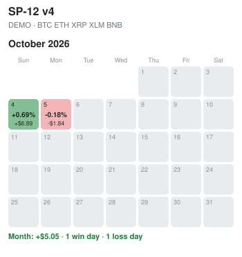
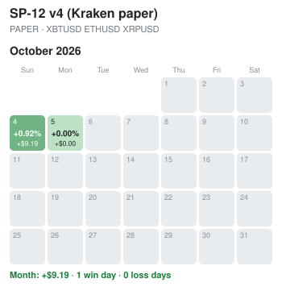
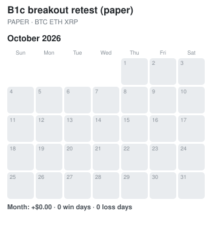
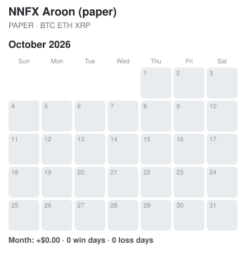

# P/L calendar and strategy cards

Updated automatically every hour (2026-10-05 10:19 EDT). Days are Eastern time. Green = closed profit that day, red = closed loss, grey = no closed trades; stronger colour = bigger day (full colour at 2% of the balance). Each square: the day's % change of the balance and the $ amount. DEMO = OKX demo account orders, PAPER = simulated, no orders. Made by pl_calendar.py.

## Combined OKX demo account

Closed P/L so far: +$2.73 · 1 win day · 1 loss day

## Strategy cards

One card per bot. Chart: blue = the bot's real balance (demo or paper fills, open trades valued now); dashed grey = the same bot.py code replayed on the same candles since the start (the backtest engine). A gap between them = fills, timing, or a settings change during the period (see journal/changes.json). 'Backtest' stats are the long-run research numbers (2022-now).

### SP-12 v4  ·  DEMO

OKX · BTC ETH XRP XLM BNB · 4-hour candles · started 2026-10-04 · balance now 1,010.84

| | Trades | Win % | PF | Max DD |
|---|---|---|---|---|
| Backtest, long run (research, 2022-now) | - | 36% | 1.23 | -10.2% |
| Backtest replay since start | 0 | - | - | -0.2% |
| Live (demo) since start | 1 | 0% | 0.00 | -0.1% |

### SP-12 v4 (Kraken paper)  ·  PAPER

Kraken · XBTUSD ETHUSD XRPUSD · 4-hour candles · started 2026-10-04 · balance now 1,017.57

| | Trades | Win % | PF | Max DD |
|---|---|---|---|---|
| Backtest, long run (research, 2022-now) | - | 36% | 1.23 | -9.9% |
| Backtest replay since start | 0 | - | - | -0.1% |
| Live (paper) since start | 0 | - | - | 0.0% |

### SP-12 v2  ·  PAUSED

OKX · ETH SOL · 4-hour candles · started 2026-10-04 · balance now 996.68

| | Trades | Win % | PF | Max DD |
|---|---|---|---|---|
| Backtest, long run (research, 2022-now) | - | - | - | - |
| Backtest replay since start | 0 | - | - | 0.0% |
| Live (paused) since start | 1 | 0% | 0.00 | -0.3% |

### SP-12 v2 (gold paper)  ·  PAUSED

OKX · XAUT · 4-hour candles · started 2026-10-04 · balance now 1,000.00

| | Trades | Win % | PF | Max DD |
|---|---|---|---|---|
| Backtest, long run (research, 2022-now) | - | - | - | - |
| Backtest replay since start | 0 | - | - | 0.0% |
| Live (paused) since start | 0 | - | - | 0.0% |

### Trend Rider  ·  DEMO

OKX · BTC ETH SOL BNB SUI TRX · 4-hour candles · started 2026-10-04 · balance now 1,000.73

| | Trades | Win % | PF | Max DD |
|---|---|---|---|---|
| Backtest, long run (research, 2022-now) | - | 41% | 1.94 | -7.4% |
| Backtest replay since start | 0 | - | - | -0.2% |
| Live (demo) since start | 0 | - | - | 0.0% |

### B1c breakout retest (paper)  ·  PAPER

OKX · BTC ETH XRP · 1-hour candles · started 2026-10-05 · balance now 1,000.00

| | Trades | Win % | PF | Max DD |
|---|---|---|---|---|
| Backtest, long run (research, 2022-now) | - | 46% | 1.17 | -5.8% |
| Backtest replay since start | 0 | - | - | 0.0% |
| Live (paper) since start | 0 | - | - | 0.0% |

### B3 pairs (paper)  ·  PAPER

OKX · ETH XRP BTC · daily candles · started 2026-10-05 · balance now 1,000.00

| | Trades | Win % | PF | Max DD |
|---|---|---|---|---|
| Backtest, long run (research, 2022-now) | - | 44% | 1.52 | -5.1% |
| Backtest replay since start | 0 | - | - | 0.0% |
| Live (paper) since start | 0 | - | - | 0.0% |

### NNFX Aroon (paper)  ·  PAPER

OKX · BTC ETH XRP · daily candles · started 2026-10-05 · balance now 1,000.00

| | Trades | Win % | PF | Max DD |
|---|---|---|---|---|
| Backtest, long run (research, 2022-now) | - | 61% | 2.20 | -5.4% |
| Backtest replay since start | 0 | - | - | 0.0% |
| Live (paper) since start | 0 | - | - | 0.0% |

### Trend Rider (gold paper)  ·  PAUSED

OKX · XAUT · 4-hour candles · started 2026-10-04 · balance now 1,000.00

| | Trades | Win % | PF | Max DD |
|---|---|---|---|---|
| Backtest, long run (research, 2022-now) | - | - | - | - |
| Backtest replay since start | 0 | - | - | 0.0% |
| Live (paused) since start | 0 | - | - | 0.0% |

## Per-bot P/L calendars

### SP-12 v4

Closed P/L so far: +$6.05 · 1 win day · 1 loss day

### SP-12 v4 (Kraken paper)

Closed P/L so far: +$9.19 · 1 win day · 0 loss days

### Trend Rider

Closed P/L so far: +$0.00 · 0 win days · 0 loss days

### B1c breakout retest (paper)

Closed P/L so far: +$0.00 · 0 win days · 0 loss days

### B3 pairs (paper)

Closed P/L so far: +$0.00 · 0 win days · 0 loss days

### NNFX Aroon (paper)

Closed P/L so far: +$0.00 · 0 win days · 0 loss days

