# P/L calendar and strategy cards

Updated automatically every hour (2026-10-18 17:33 EDT). Days are Eastern time. Green = closed profit that day, red = closed loss, grey = no closed trades; stronger colour = bigger day (full colour at 2% of the balance). Each square: the day's % change of the balance and the $ amount. DEMO = OKX demo account orders, PAPER = simulated, no orders. Made by pl_calendar.py.

## Combined OKX demo account

Closed P/L so far: -$11.09 · 1 win day · 3 loss days

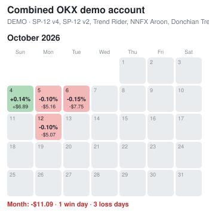

## The Claudes vs the bots

Both Claudes trade on judgment, on paper, since Oct 6 2026: same $1,000 start, same 0.35% fee, same risk rules enforced in code (0.5% per trade, stop on every trade, max 3 open, 12% guard). Claude (terminal) writes briefs, journal and lessons in [analyst/](analyst/); Chrome Claude trades through [analyst/chrome/requests.md](analyst/chrome/requests.md).

| | Balance | Change | Closed trades |
|---|---|---|---|
| **Claude (Analyst)** | **994.34** | **-0.57%** | 1 (0 won) |
| **Chrome Claude** | **1,000.00** | **+0.00%** | 0 |
| Trend Rider | 987.18 | -1.28% | |
| Donchian Trend | 1,000.00 | +0.00% | |
| NNFX Aroon | 1,000.00 | +0.00% | |

Closed P/L only; open trades count when they close.

## The three piles

- HOLD (long-term, PAPER): weekly dip-DCA buyer, $10/week into BTC + XRP, double when 20%+ below the 200-day average. Paid $20.00, worth $18.37. Profit sweeper (25% of wins into this pile): OFF until real money. Buys: hold_pile.csv.
- LIVE (REAL MONEY, Binance.US, $50 each): Trend Rider (LIVE Binance.US), Turtle 55/20 (LIVE Binance.US)
- ACTIVE (trading, OKX demo): Trend Rider, NNFX Aroon, Donchian Trend
- BINANCE.US (same bots, paper, 0.02% fee): Trend Rider (Binance.US paper), Donchian Trend (Binance.US paper), NNFX Aroon (Binance.US paper), Turtle 55/20 (Binance.US paper), RSI(2) snap-back (Binance.US paper), Breakout II + BTC switch (Binance.US paper), SP-12 v4 (Binance.US paper), B1c breakout retest (Binance.US paper)
- HOLD (BTC protected hold, paper): BTC Protected Hold (paper)
- INCUBATING (paper forward tests): Follow Line (paper), Double Bottom (paper), Confluence Rank (paper), B3 pairs (paper)
- RANGE: none yet. No range bot has passed a test (research/N1_RANGE.md, B2), so this pile stays empty until one does.
- RETIRED (failed at real fees or long history): SP-12 v4, SP-12 v4 (Kraken paper), B1c breakout retest (paper), NNFX Aroon (paper), SP-12 v2, SP-12 v2 (gold paper), Trend Rider (gold paper)

## Growth: demo vs paper

Average balance per bot, each bot starting at $1,000: the active demo bots (3, solid) vs the paper bots (14, dashed). Demo now $995.73 (-0.43%), paper now $993.23 (-0.68%).

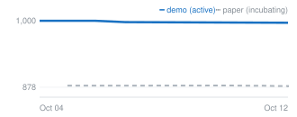

## Strategy cards

One card per bot. Chart: blue = the bot's real balance (demo or paper fills, open trades valued now); dashed grey = the same bot.py code replayed on the same candles since the start (the backtest engine). A gap between them = fills, timing, or a settings change during the period (see journal/changes.json). 'Backtest' stats are the long-run research numbers (2022-now).

### SP-12 v4  ·  PAUSED

OKX · BTC ETH XRP XLM BNB · 4-hour candles · started 2026-10-04 · balance now 1,005.05

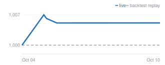

| | Trades | Win % | PF | Max DD |
|---|---|---|---|---|
| Backtest, long run (research, 2022-now) | - | 34% | 1.40 | -9.6% |
| Backtest replay since start | 0 | - | - | 0.0% |
| Live (paused) since start | 2 | 50% | 7.01 | -0.2% |

### SP-12 v4 (Kraken paper)  ·  PAUSED

Kraken · XBTUSD ETHUSD XRPUSD · 4-hour candles · started 2026-10-04 · balance now 996.56

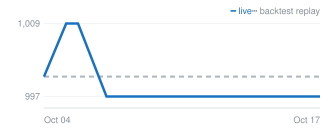

| | Trades | Win % | PF | Max DD |
|---|---|---|---|---|
| Backtest, long run (research, 2022-now) | - | 33% | 1.46 | -9.5% |
| Backtest replay since start | 0 | - | - | 0.0% |
| Live (paused) since start | 2 | 50% | 0.73 | -1.3% |

### SP-12 v2  ·  PAUSED

OKX · ETH SOL · 4-hour candles · started 2026-10-04 · balance now 996.68

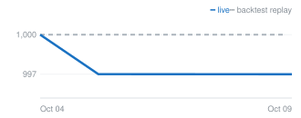

| | Trades | Win % | PF | Max DD |
|---|---|---|---|---|
| Backtest, long run (research, 2022-now) | - | - | - | - |
| Backtest replay since start | 0 | - | - | 0.0% |
| Live (paused) since start | 1 | 0% | 0.00 | -0.3% |

### SP-12 v2 (gold paper)  ·  PAUSED

OKX · XAUT · 4-hour candles · started 2026-10-04 · balance now 1,000.00

| | Trades | Win % | PF | Max DD |
|---|---|---|---|---|
| Backtest, long run (research, 2022-now) | - | - | - | - |
| Backtest replay since start | 0 | - | - | 0.0% |
| Live (paused) since start | 0 | - | - | 0.0% |

### Trend Rider  ·  DEMO

OKX · BTC ETH SOL BNB SUI TRX · 4-hour candles · started 2026-10-04 · balance now 987.18

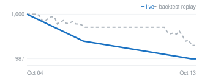

| | Trades | Win % | PF | Max DD |
|---|---|---|---|---|
| Backtest, long run (research, 2022-now) | - | 33% | 1.66 | -9.6% |
| Backtest replay since start | 3 | 0% | 0.00 | -1.4% |
| Live (demo) since start | 2 | 0% | 0.00 | -1.3% |

### B1c breakout retest (paper)  ·  PAUSED

OKX · BTC ETH XRP · 1-hour candles · started 2026-10-05 · balance now 1,000.00

| | Trades | Win % | PF | Max DD |
|---|---|---|---|---|
| Backtest, long run (research, 2022-now) | - | 46% | 1.17 | -5.8% |
| Backtest replay since start | 0 | - | - | 0.0% |
| Live (paused) since start | 0 | - | - | 0.0% |

### B3 pairs (paper)  ·  PAPER

OKX · ETH XRP BTC · daily candles · started 2026-10-05 · balance now 1,000.00

| | Trades | Win % | PF | Max DD |
|---|---|---|---|---|
| Backtest, long run (research, 2022-now) | - | 44% | 1.52 | -5.1% |
| Backtest replay since start | 0 | - | - | 0.0% |
| Live (paper) since start | 0 | - | - | 0.0% |

### NNFX Aroon (paper)  ·  PAUSED

OKX · BTC ETH XRP · daily candles · started 2026-10-05 · balance now 1,000.00

| | Trades | Win % | PF | Max DD |
|---|---|---|---|---|
| Backtest, long run (research, 2022-now) | - | 61% | 2.20 | -5.4% |
| Backtest replay since start | 0 | - | - | 0.0% |
| Live (paused) since start | 0 | - | - | 0.0% |

### NNFX Aroon  ·  DEMO

OKX · BTC ETH XRP · daily candles · started 2026-10-06 · balance now 1,000.00

| | Trades | Win % | PF | Max DD |
|---|---|---|---|---|
| Backtest, long run (research, 2022-now) | - | 59% | 1.89 | -6.1% |
| Backtest replay since start | 0 | - | - | 0.0% |
| Live (demo) since start | 0 | - | - | 0.0% |

### Donchian Trend  ·  DEMO

OKX · BTC ETH SOL XRP BNB · daily candles · started 2026-10-06 · balance now 1,000.00

| | Trades | Win % | PF | Max DD |
|---|---|---|---|---|
| Backtest, long run (research, 2022-now) | - | 31% | 2.46 | -9.7% |
| Backtest replay since start | 0 | - | - | 0.0% |
| Live (demo) since start | 0 | - | - | 0.0% |

### Trend Rider (Binance.US paper)  ·  PAPER

Binance.US · BTC ETH SOL BNB SUI TRX · 4-hour candles · started 2026-10-07 · balance now 989.03

| | Trades | Win % | PF | Max DD |
|---|---|---|---|---|
| Backtest, long run (research, 2022-now) | - | - | - | - |
| Backtest replay since start | 2 | 0% | 0.00 | -1.1% |
| Live (paper) since start | 2 | 0% | 0.00 | -1.1% |

### Trend Rider 1H (Binance.US paper)  ·  PAPER

Binance.US · BTC ETH SOL BNB SUI · 1-hour candles · started - · balance now 970.72

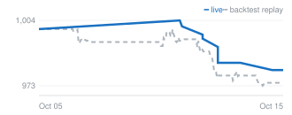

| | Trades | Win % | PF | Max DD |
|---|---|---|---|---|
| Backtest, long run (research, 2022-now) | - | - | - | - |
| Backtest replay since start | 14 | 7% | 0.11 | -3.6% |
| Live (paper) since start | 12 | 8% | 0.12 | -3.3% |

### Donchian Trend (Binance.US paper)  ·  PAPER

Binance.US · BTC ETH SOL XRP BNB · daily candles · started 2026-10-07 · balance now 1,000.00

| | Trades | Win % | PF | Max DD |
|---|---|---|---|---|
| Backtest, long run (research, 2022-now) | - | - | - | - |
| Backtest replay since start | 0 | - | - | 0.0% |
| Live (paper) since start | 0 | - | - | 0.0% |

### NNFX Aroon (Binance.US paper)  ·  PAPER

Binance.US · BTC ETH XRP · daily candles · started 2026-10-07 · balance now 1,000.00

| | Trades | Win % | PF | Max DD |
|---|---|---|---|---|
| Backtest, long run (research, 2022-now) | - | - | - | - |
| Backtest replay since start | 0 | - | - | 0.0% |
| Live (paper) since start | 0 | - | - | 0.0% |

### Turtle 55/20 (Binance.US paper)  ·  PAPER

Binance.US · BTC ETH SOL XRP BNB · daily candles · started 2026-10-07 · balance now 1,000.00

| | Trades | Win % | PF | Max DD |
|---|---|---|---|---|
| Backtest, long run (research, 2022-now) | - | - | - | - |
| Backtest replay since start | 0 | - | - | 0.0% |
| Live (paper) since start | 0 | - | - | 0.0% |

### RSI(2) snap-back (Binance.US paper)  ·  PAPER

Binance.US · BTC ETH SOL XRP BNB · daily candles · started 2026-10-07 · balance now 1,002.15

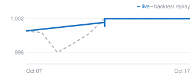

| | Trades | Win % | PF | Max DD |
|---|---|---|---|---|
| Backtest, long run (research, 2022-now) | - | - | - | - |
| Backtest replay since start | 5 | 60% | 2.98 | -0.4% |
| Live (paper) since start | 5 | 60% | 2.96 | -0.1% |

### Breakout II + BTC switch (Binance.US paper)  ·  PAPER

Binance.US · BTC ETH SOL XRP BNB · daily candles · started 2026-10-08 · balance now 1,000.00

| | Trades | Win % | PF | Max DD |
|---|---|---|---|---|
| Backtest, long run (research, 2022-now) | - | - | - | - |
| Backtest replay since start | 0 | - | - | 0.0% |
| Live (paper) since start | 0 | - | - | 0.0% |

### SP-12 v4 (Binance.US paper)  ·  PAPER

Binance.US · BTC ETH XRP XLM BNB · 4-hour candles · started 2026-10-07 · balance now 1,000.00

| | Trades | Win % | PF | Max DD |
|---|---|---|---|---|
| Backtest, long run (research, 2022-now) | - | - | - | - |
| Backtest replay since start | 0 | - | - | 0.0% |
| Live (paper) since start | 0 | - | - | 0.0% |

### B1c breakout retest (Binance.US paper)  ·  PAPER

Binance.US · BTC ETH XRP · 1-hour candles · started 2026-10-07 · balance now 1,000.00

| | Trades | Win % | PF | Max DD |
|---|---|---|---|---|
| Backtest, long run (research, 2022-now) | - | - | - | - |
| Backtest replay since start | 0 | - | - | 0.0% |
| Live (paper) since start | 0 | - | - | 0.0% |

### Trend Rider (LIVE Binance.US)  ·  PAUSED

Binance.US · BTC ETH SOL BNB SUI TRX · 4-hour candles · started 2026-10-07 · balance now 49.76

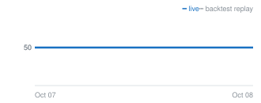

| | Trades | Win % | PF | Max DD |
|---|---|---|---|---|
| Backtest, long run (research, 2022-now) | - | 40% | 2.38 | -9.3% |
| Backtest replay since start | 0 | - | - | 0.0% |
| Live (paused) since start | 1 | 0% | 0.00 | -0.5% |

### Turtle 55/20 (LIVE Binance.US)  ·  PAUSED

Binance.US · BTC ETH SOL XRP BNB · daily candles · started 2026-10-07 · balance now 50.00

| | Trades | Win % | PF | Max DD |
|---|---|---|---|---|
| Backtest, long run (research, 2022-now) | - | 44% | 5.42 | -13.6% |
| Backtest replay since start | 0 | - | - | 0.0% |
| Live (paused) since start | 0 | - | - | 0.0% |

### BTC Protected Hold (paper)  ·  PAPER

OKX · BTC · daily candles · started 2026-10-06 · balance now 943.38

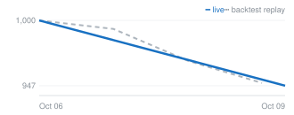

| | Trades | Win % | PF | Max DD |
|---|---|---|---|---|
| Backtest, long run (research, 2022-now) | - | 18% | 1.91 | -38.6% |
| Backtest replay since start | 0 | - | - | -5.4% |
| Live (paper) since start | 0 | - | - | -5.7% |

### Follow Line (paper)  ·  PAPER

OKX · BTC ETH SOL XRP BNB · daily candles · started 2026-10-06 · balance now 1,000.00

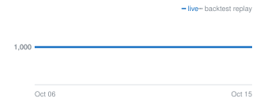

| | Trades | Win % | PF | Max DD |
|---|---|---|---|---|
| Backtest, long run (research, 2022-now) | - | 34% | 2.45 | -8.4% |
| Backtest replay since start | 0 | - | - | 0.0% |
| Live (paper) since start | 0 | - | - | 0.0% |

### Double Bottom (paper)  ·  PAPER

OKX · BTC ETH SOL XRP BNB · daily candles · started 2026-10-06 · balance now 1,000.00

| | Trades | Win % | PF | Max DD |
|---|---|---|---|---|
| Backtest, long run (research, 2022-now) | - | 43% | 2.17 | -7.5% |
| Backtest replay since start | 0 | - | - | 0.0% |
| Live (paper) since start | 0 | - | - | 0.0% |

### Confluence Rank (paper)  ·  PAPER

OKX · BTC ETH SOL XRP BNB · daily candles · started 2026-10-06 · balance now 1,000.00

| | Trades | Win % | PF | Max DD |
|---|---|---|---|---|
| Backtest, long run (research, 2022-now) | - | 41% | 2.84 | -5.7% |
| Backtest replay since start | 0 | - | - | 0.0% |
| Live (paper) since start | 0 | - | - | 0.0% |

### Trend Rider (gold paper)  ·  PAUSED

OKX · XAUT · 4-hour candles · started 2026-10-04 · balance now 1,000.00

| | Trades | Win % | PF | Max DD |
|---|---|---|---|---|
| Backtest, long run (research, 2022-now) | - | - | - | - |
| Backtest replay since start | 0 | - | - | 0.0% |
| Live (paused) since start | 0 | - | - | 0.0% |

## Per-bot P/L calendars

### Trend Rider

Closed P/L so far: -$12.82 · 0 win days · 2 loss days

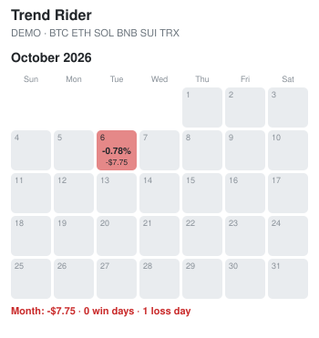

### B3 pairs (paper)

Closed P/L so far: +$0.00 · 0 win days · 0 loss days

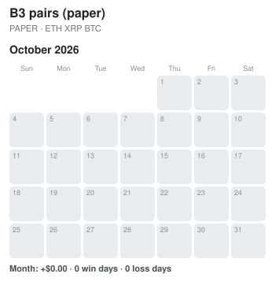

### NNFX Aroon

Closed P/L so far: +$0.00 · 0 win days · 0 loss days

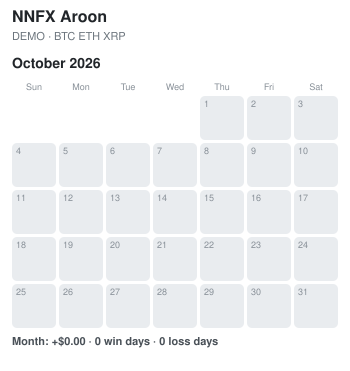

### Donchian Trend

Closed P/L so far: +$0.00 · 0 win days · 0 loss days

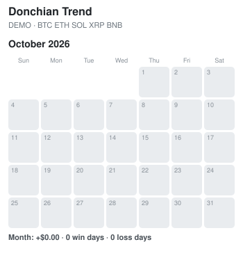

### Trend Rider (Binance.US paper)

Closed P/L so far: -$10.98 · 0 win days · 2 loss days

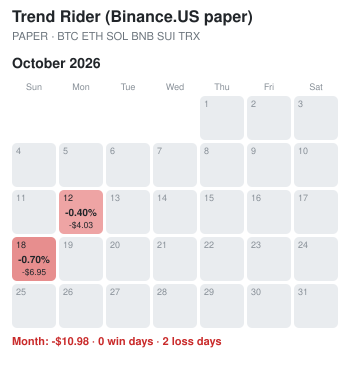

### Trend Rider 1H (Binance.US paper)

Closed P/L so far: -$29.28 · 1 win day · 5 loss days

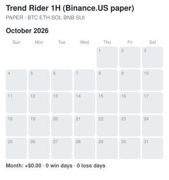

### Donchian Trend (Binance.US paper)

Closed P/L so far: +$0.00 · 0 win days · 0 loss days

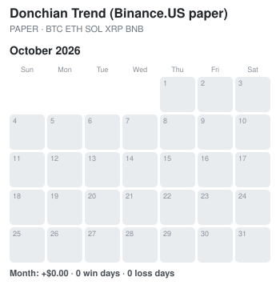

### NNFX Aroon (Binance.US paper)

Closed P/L so far: +$0.00 · 0 win days · 0 loss days

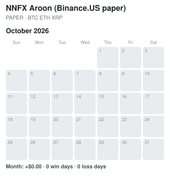

### Turtle 55/20 (Binance.US paper)

Closed P/L so far: +$0.00 · 0 win days · 0 loss days

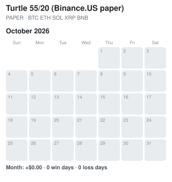

### RSI(2) snap-back (Binance.US paper)

Closed P/L so far: +$2.14 · 1 win day · 0 loss days

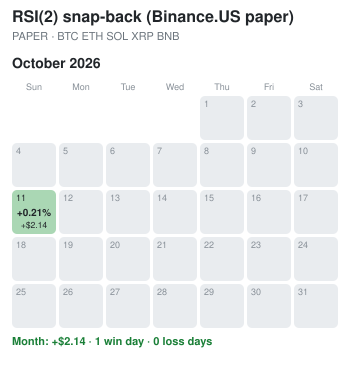

### Breakout II + BTC switch (Binance.US paper)

Closed P/L so far: +$0.00 · 0 win days · 0 loss days

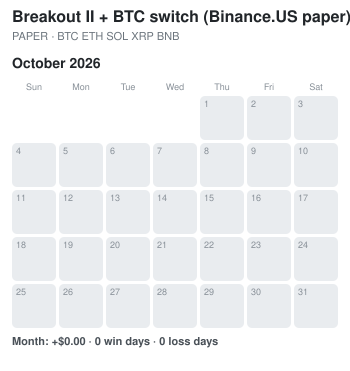

### SP-12 v4 (Binance.US paper)

Closed P/L so far: +$0.00 · 0 win days · 0 loss days

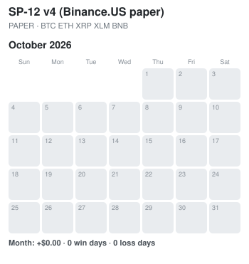

### B1c breakout retest (Binance.US paper)

Closed P/L so far: +$0.00 · 0 win days · 0 loss days

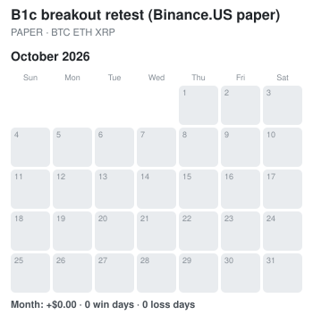

### BTC Protected Hold (paper)

Closed P/L so far: +$0.00 · 0 win days · 0 loss days

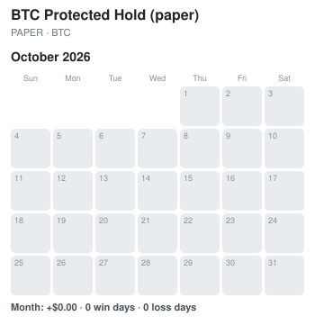

### Follow Line (paper)

Closed P/L so far: +$0.00 · 0 win days · 0 loss days

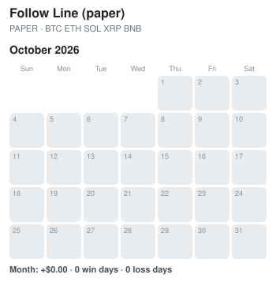

### Double Bottom (paper)

Closed P/L so far: +$0.00 · 0 win days · 0 loss days

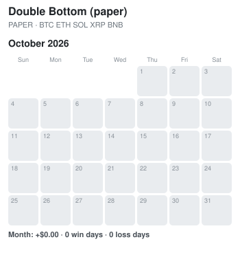

### Confluence Rank (paper)

Closed P/L so far: +$0.00 · 0 win days · 0 loss days

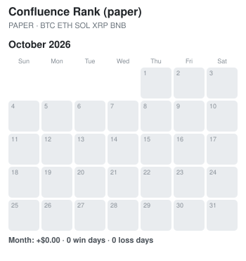

