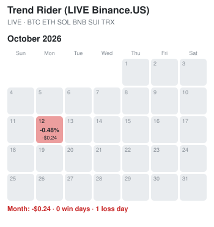
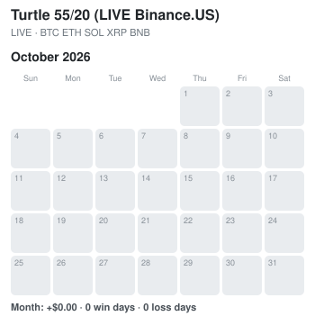

# P/L calendar and strategy cards

Updated automatically every hour (2026-10-07 22:43 EDT). Days are Eastern time. Green = closed profit that day, red = closed loss, grey = no closed trades; stronger colour = bigger day (full colour at 2% of the balance). Each square: the day's % change of the balance and the $ amount. DEMO = OKX demo account orders, PAPER = simulated, no orders. Made by pl_calendar.py.

## Combined OKX demo account

Closed P/L so far: -$6.02 · 1 win day · 2 loss days

## The Claudes vs the bots

Both Claudes trade on judgment, on paper, since Oct 6 2026: same $1,000 start, same 0.35% fee, same risk rules enforced in code (0.5% per trade, stop on every trade, max 3 open, 12% guard). Claude (terminal) writes briefs, journal and lessons in [analyst/](analyst/); Chrome Claude trades through [analyst/chrome/requests.md](analyst/chrome/requests.md).

| | Balance | Change | Closed trades |
|---|---|---|---|
| **Claude (Analyst)** | **1,000.00** | **+0.00%** | 0 |
| **Chrome Claude** | **1,000.00** | **+0.00%** | 0 |
| Trend Rider | 992.25 | -0.77% | |
| Donchian Trend | 1,000.00 | +0.00% | |
| NNFX Aroon | 1,000.00 | +0.00% | |

Closed P/L only; open trades count when they close.

- **Claude (Analyst), open LINK:** bought 13.55 on 2026-10-07 03:00 UTC, stop 12.85. Why: Uptrend (+15% 30d) pulling back -10% this week; 13.5 is the daily 20 EMA, the first support in a healthy uptrend. Buy the dip there.
- **Claude (Analyst), waiting BTC:** buy if price goes above 87500, stop 84900. Why: Uptrend (above daily 20/50/200 EMA), 2-day tight box 85.1-86.7k under the 87.4k high. Buy only if it breaks out above the high.
- **Claude (Analyst), waiting SOL:** buy if price goes above 125.3, stop 118.5. Why: Strongest of the six (+17% in 30 days), above all daily EMAs, coiling 119-122 under the 125 high. Buy the breakout only.
- **Chrome Claude, waiting BTC:** buy if price goes above 87300, stop 84950. Why: higher lows since the Oct 2 dip to 83.9k, coiling in an 85k-87k range; a break over the Oct 3 high (87.2k) opens a move up
- **Chrome Claude, waiting SOL:** buy if price goes above 122.4, stop 118.8. Why: holding a 119-122 range after the Oct 2 low at 117.1; a break over 122.3 clears the last two days' highs

## Strategy cards

(cards unavailable this hour: '1HD')

## Per-bot P/L calendars

### Trend Rider

Closed P/L so far: -$7.75 · 0 win days · 1 loss day

### B3 pairs (paper)

Closed P/L so far: +$0.00 · 0 win days · 0 loss days

### NNFX Aroon

Closed P/L so far: +$0.00 · 0 win days · 0 loss days

### Donchian Trend

Closed P/L so far: +$0.00 · 0 win days · 0 loss days

### Trend Rider (Binance.US paper)

Closed P/L so far: +$0.00 · 0 win days · 0 loss days

### Trend Rider 1H (Binance.US paper)

Closed P/L so far: +$0.00 · 0 win days · 0 loss days

### Donchian Trend (Binance.US paper)

Closed P/L so far: +$0.00 · 0 win days · 0 loss days

### NNFX Aroon (Binance.US paper)

Closed P/L so far: +$0.00 · 0 win days · 0 loss days

### Turtle 55/20 (Binance.US paper)

Closed P/L so far: +$0.00 · 0 win days · 0 loss days

### RSI(2) snap-back (Binance.US paper)

Closed P/L so far: +$0.00 · 0 win days · 0 loss days

### SP-12 v4 (Binance.US paper)

Closed P/L so far: +$0.00 · 0 win days · 0 loss days

### B1c breakout retest (Binance.US paper)

Closed P/L so far: +$0.00 · 0 win days · 0 loss days

### Trend Rider (LIVE Binance.US)

Closed P/L so far: +$0.00 · 0 win days · 0 loss days

### Turtle 55/20 (LIVE Binance.US)

Closed P/L so far: +$0.00 · 0 win days · 0 loss days

### BTC Protected Hold (paper)

Closed P/L so far: +$0.00 · 0 win days · 0 loss days

### Follow Line (paper)

Closed P/L so far: +$0.00 · 0 win days · 0 loss days

### Double Bottom (paper)

Closed P/L so far: +$0.00 · 0 win days · 0 loss days

### Confluence Rank (paper)

Closed P/L so far: +$0.00 · 0 win days · 0 loss days

